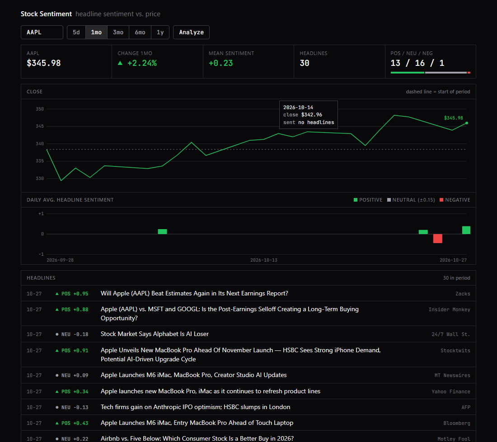
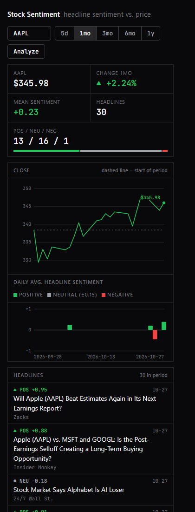
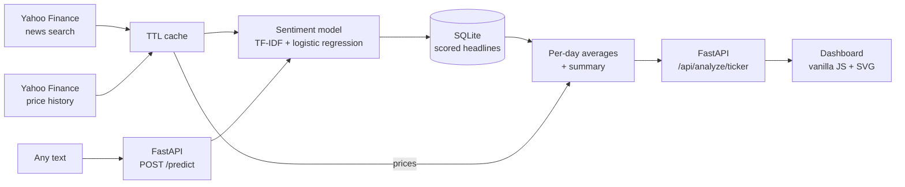

# Stock Sentiment Dashboard

[](https://github.com/TJDEBUGGED/stock-sentiment/actions/workflows/ci.yml)
[](LICENSE)

Pulls recent news headlines for a stock, scores each one with a sentiment model I trained on finance text, and lines the daily sentiment up against the price chart.

**Live demo:** https://stock-sentiment-01zz.onrender.com (free tier: the first load after idle takes about a minute to wake, and stored headline history resets whenever the service restarts)





## How it works



1. **Fetch** headlines (`yf.Search`) and daily closing prices (`yf.Ticker.history`). No API keys needed. Responses are cached in memory (news 10 min, prices 5 min).
2. **Score** each headline with a TF-IDF + Logistic Regression classifier (3 classes: negative / neutral / positive). The score is signed: `P(positive) - P(negative)`, from -1 to +1. The label is the most likely class.
3. **Store** every scored headline in SQLite (de-duplicated by uuid). Yahoo only returns the latest handful of headlines per request, so history accumulates each time you look up a ticker.
4. **Aggregate** into a per-day average sentiment and a summary (mean score, positive / neutral / negative counts), limited to the selected period.
5. **Serve** it as JSON from FastAPI and plot it: price line on top, daily sentiment bars underneath, sharing one date axis.

## Run it (Windows PowerShell)

```powershell
# 1. Create a virtual environment and install dependencies
python -m venv venv
.\venv\Scripts\Activate.ps1
pip install -r requirements.txt

# 2. Train the model (downloads the finance datasets into data/raw/ on first run)
python train_finance.py

# 3. Sanity-check the data fetcher
python data/fetcher.py AAPL

# 4. Start the app
uvicorn app.main:app --reload
# open http://localhost:8000   (interactive API docs: http://localhost:8000/docs)
```

Pickled models are tied to the scikit-learn version that trained them (`requirements.txt` pins it). If you see a version warning, re-run `train_finance.py`.

## Tests

```powershell
python -m pytest -v
```

43 tests, run on every push by GitHub Actions. No network is needed: the pipeline takes fake `get_news` / `get_prices` / scorer functions and a temp database, and the cache tests use a fake clock. They cover aggregation, de-duplication, period filtering, failure handling, the cache, API validation and `/predict` (which uses the real shipped model).

## API

### `GET /api/analyze/{ticker}?period=1mo`
`period` is one of `5d, 1mo, 3mo, 6mo, 1y`. Returns `prices`, `articles` (each with `score` and `label`), `daily_sentiment`, `summary` and `warnings`.

If Yahoo's news lookup fails, the response still contains prices and the headlines already stored, with a message in `warnings` (shown in the dashboard). If the price lookup fails the API returns 502.

### `POST /predict`
Scores any text, up to 50 texts per request and 1,000 characters each (otherwise `422`).

```bash
curl -X POST http://localhost:8000/predict -H "content-type: application/json" \
  -d '{"texts": ["Boeing wins $14.7 billion missile contract", "Company misses earnings and cuts full-year guidance"]}'
```

```json
{
  "results": [
    {
      "text": "Boeing wins $14.7 billion missile contract",
      "label": "neutral",
      "score": 0.2773,
      "probabilities": { "negative": 0.1084, "neutral": 0.5058, "positive": 0.3858 }
    },
    {
      "text": "Company misses earnings and cuts full-year guidance",
      "label": "negative",
      "score": -0.9288,
      "probabilities": { "negative": 0.9388, "neutral": 0.0513, "positive": 0.0099 }
    }
  ]
}
```

This is real output, including a miss: the first headline is clearly good news but comes back neutral. That is the known weakness described below.

## The model, and how well it works

My first model was trained on movie reviews (see the `sentiment-analyser` project). It scored 78.5% on its own held-out test set, but that did not carry over to stock news, so I measured it and retrained on finance text.

**Training data:** [Twitter Financial News Sentiment](https://huggingface.co/datasets/zeroshot/twitter-financial-news-sentiment) (about 9.5k labelled finance posts) plus 80% of [Financial PhraseBank](https://huggingface.co/datasets/takala/financial_phrasebank) (75%-agreement version). Links and `$TICKER` tags are stripped.

| Test set | Movie model | Finance model |
|---|---|---|
| 119 real Yahoo Finance headlines, 3-class accuracy | 28.6% | **57.1%** |
| Same headlines, direction when the model picks a side | 50.0% (28 headlines) | **82.4%** (34 headlines) |
| Twitter finance test split (accuracy / macro-F1) | n/a | 82.6% / 0.772 |
| PhraseBank held-out 20% (accuracy / macro-F1) | n/a | 84.2% / 0.800 |

**How the 119-headline benchmark was made** (`eval/`): headlines were pulled for 15 tickers, and **labelled by Claude (an LLM), not by a human annotator**, using one rule: is this news good, bad or neutral for the stock? The model's scores were not shown during labelling and the benchmark is never used for training. With only 119 headlines the margin of error is roughly ±9 points, so treat these as indicative. Reproduce with `python -m eval.evaluate`.

## Limitations

- **Still under-calls positive news.** On the benchmark, 26 of 47 positive headlines are scored neutral. The training data is tweets and earnings sentences, which differ from news headlines.
- **Noisy headlines.** `yf.Search` returns anything that mentions the ticker, so some headlines are mostly about other companies. I tested filtering to headlines that name the company: accuracy was the same (57.4% vs 56.9%) and it would have discarded 49% of the data, so I left it out.
- **Two further upgrade attempts did not help on real headlines.** Adding character n-grams improved the tweet-style test sets slightly (mean macro-F1 0.786 to 0.799) but left benchmark accuracy unchanged at 57.1% (`python -m eval.compare_models`). Adding 387 more labelled Yahoo headlines looked strong in cross-validation (macro-F1 0.54 to 0.64) but not on the benchmark (57.1% to 56.3%, 95% CI [-7.6%, +5.9%]), because related stories leak across folds (`python -m eval.compare_indomain`). Getting past roughly 57% likely needs a stronger model (for example FinBERT, which does not fit Render's free 512 MB tier) or human-quality labels.
- **Tuning the neutral class didn't help.** Down-weighting P(neutral) looked good on the whole benchmark, but on unseen halves the gain was +0.003 macro-F1 against noise of ±0.06 (`python -m eval.tune_neutral`), so the model is unchanged.
- **Why `yf.Search`, not `Ticker.news`.** `Ticker(...).news` returned an empty list; `yf.Search(ticker).news` works. Yahoo has no official API, so this can change.
- **Thin history at first.** Only the latest headlines come back per request, so the sentiment trend fills in as the app is used. Headlines are stored in a local SQLite file, which the free hosting tier wipes on restart.
- **No authentication or rate limiting** on the public endpoints.
- **Dataset licence.** Financial PhraseBank is licensed CC BY-NC-SA (non-commercial). It is downloaded at training time and not redistributed here.
- **Not financial advice.** Headline sentiment is a weak signal and this app does not predict prices.

## Project structure

```
stock-sentiment/
├── data/
│   ├── fetcher.py        # headlines + prices from yfinance (cached)
│   ├── cache.py          # small TTL cache for Yahoo calls
│   ├── store.py          # SQLite store for scored headlines
│   └── finance_data.py   # downloads and loads the training datasets
├── analysis/
│   ├── sentiment.py      # loads the model, scores text (single and batch)
│   └── pipeline.py       # fetch -> score -> store -> aggregate
├── app/main.py           # FastAPI app (/api/analyze, /predict, /health)
├── frontend/             # dashboard (vanilla HTML/CSS/JS + SVG, no libraries)
├── eval/                 # benchmark headlines, labels, evaluation + experiment scripts
├── tests/                # pytest suite (pipeline, cache, API, /predict)
├── docs/                 # README screenshots
├── .github/workflows/    # CI: runs the tests on every push
├── train_finance.py      # trains the model, writes model/
├── model/                # classifier.pkl + vectorizer.pkl
├── render.yaml           # Render deployment blueprint
└── requirements.txt
```

## License

Code is released under the [MIT License](LICENSE). The Financial PhraseBank dataset keeps its own non-commercial license.
